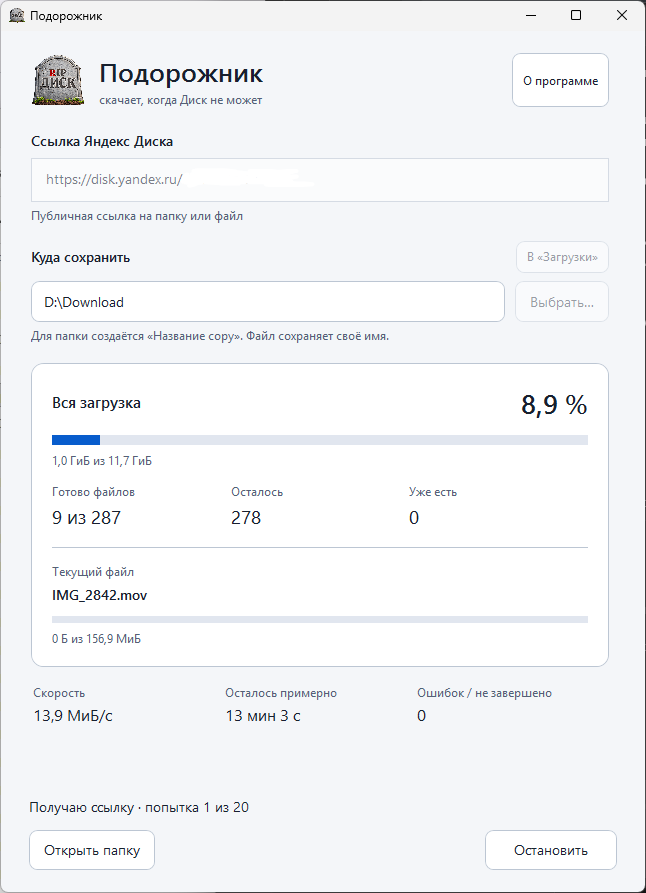

# Подорожник для Windows

Подорожник — скачает, когда Диск не может.

**Рабочая версия для Windows 10 / 11 x64 — 0.1.0-dev.8 (предварительный выпуск).**

Скачивает публичные файлы и папки Яндекс Диска с вложениями, проверяет целостность и продолжает незавершённую загрузку. Вход в аккаунт не нужен.

**[Скачать установщик Windows](https://github.com/sirdimitry/plantain/releases/download/windows-v0.1.0-dev.8/Plantain-0.1.0-dev.8-win-x64-Setup.exe)** · [Portable ZIP](https://github.com/sirdimitry/plantain/releases/download/windows-v0.1.0-dev.8/Plantain-0.1.0-dev.8-win-x64.zip) · [История изменений](CHANGELOG.md)

Есть [стабильная версия для macOS 1.1.1](https://github.com/sirdimitry/plantain/blob/main/README.md): [скачать DMG](https://github.com/sirdimitry/plantain/releases/tag/v1.1.1). Код macOS находится в `main`, Windows — в отдельной ветке `windows` того же репозитория.

## Скриншот приложения



Скриншот предоставлен пользователем; он сделан до перехода на Мбит/с и МБ/ГБ.

## Что готово

- Изучено поведение macOS 1.1.1, исходная точка `acb34baa815265967a81fd6e5a14d2271a5ec5e3`.
- Зафиксированы [требования к загрузчику и отличия Windows](docs/BEHAVIOR.ru.md).
- Составлена [матрица проверок и условия готовности](docs/ACCEPTANCE.ru.md).
- Заданы [порядок следующих этапов и правила версий](docs/DEVELOPMENT.ru.md).
- Реализованы API и пагинация, потоковая передача, SHA-256/MD5, проверка имеющихся файлов, докачка, отмена и ограниченные повторы.
- До 5 попыток на файл; при ошибке виден отсчёт до следующей попытки. «Пропустить» рядом со статусом переходит к следующему файлу и сохраняет текущий в списке незавершённых.
- Размеры отображаются в десятичных МБ/ГБ (1000), скорость — в Мбит/с.
- Работают общий и файловый прогресс, скорость, примерное время, счётчики и сохранение без перезаписи; раздельные таймауты заголовков, чтения и ресурса целиком.
- Сеть использует HTTPS и обычную проверку TLS; проверяется каждый redirect, cookies и сетевые учётные данные отключены. Логи и история источников не записываются.
- Защищённые операции с файлами через дескрипторы Windows: удержание родителей, открытие потомков относительно каталога, запрет обхода reparse points/junctions, проверка жёстких ссылок partial, публикация проверенного объекта без замены.
- Блокировка одновременных загрузок в одну папку, автоматически снимаемая системой при завершении процесса; отдельного lock-файла нет.
- Конфликтующие и недопустимые имена пропускаются с ошибкой; остальные файлы продолжают скачиваться. Конфликт каталога исключает его поддерево.
- После полного успеха поле ссылки очищается, итог остаётся, «Скачать» недоступна до нового ввода. При остановке или ошибках ссылка остаётся для продолжения. Смена папки сбрасывает прежний прогресс и список ошибок.
- Если что-то не завершено, появляется кнопка с белым «!» в красном круге. По нажатию — имена с расширениями, пути и причины. После остановки показываются известные незавершённые файлы. Если список папки недоступен, явно указана папка, без придуманных имён.
- Системный выбор папки, «Загрузки» через Known Folders, открытие Проводника, корректное закрытие с остановкой, временный запрос запрета автосна, светлая/тёмная тема и клавиатура.

## Установить и запустить

1. [Скачайте установщик для Windows 10/11 x64](https://github.com/sirdimitry/plantain/releases/download/windows-v0.1.0-dev.8/Plantain-0.1.0-dev.8-win-x64-Setup.exe).
2. Запустите **Setup.exe**, выберите папку и завершите установку. Ярлык рабочего стола можно включить в мастере.
3. Откройте **Подорожник** из меню «Пуск» или ярлыком.

.NET и Python устанавливать не нужно. Установка автономная, без подключения к интернету и обязательных прав администратора; по умолчанию только для вашей учётной записи. В мастер встроены вертикальный баннер и иконка Подорожника. [Подробности установки](docs/INSTALLER.ru.md) · [вертикальный баннер](installer/assets/WizardBanner.png).

Для обновления закройте программу и запустите новый установщик поверх прежней версии. Папка и ярлыки сохраняются; работающую программу установщик принудительно не закрывает. Удаление — через список приложений Windows; скачанные файлы сохраняются.

Нужна версия без установки? [Скачайте Portable ZIP](https://github.com/sirdimitry/plantain/releases/download/windows-v0.1.0-dev.8/Plantain-0.1.0-dev.8-win-x64.zip), распакуйте его в отдельную папку и запустите **Plantain.Windows.exe**. В ZIP только EXE и инструкция. У переносной версии нативные компоненты .NET извлекаются при первом запуске; установленная версия использует библиотеки в собственной подпапке `app`.

Версия рабочая, но предварительная. Минимум для установщика — Windows 10 1607 x64; фактически проверена Windows 11 x64. Windows 7/8.1 и 32-битные Windows не поддерживаются, ARM64 через x64-эмуляцию ещё не проверена. Полная матрица испытаний — ниже. Собственной цифровой подписи издателя пока нет, поэтому Windows может показать предупреждение о неизвестном издателе; SHA-256 опубликована рядом с файлами [релиза](https://github.com/sirdimitry/plantain/releases/tag/windows-v0.1.0-dev.8).

Вставьте публичную ссылку, выберите папку и нажмите «Скачать». При частичном результате откройте красный «!». Для продолжения оставьте ту же ссылку и назначение; существующие конфликтные файлы автоматически не заменяются.

Клавиши: Enter — начать, Esc — остановить; Ctrl+O — папка, Ctrl+E — список ошибок. Список закрывается кнопкой «Закрыть» или Esc. Названия и причины переносятся на строки, список поддерживает прокрутку и выделение.

## Платформы и дальнейшая работа

Платформы — Windows 10/11 x64. Стек — C# / .NET 10 LTS / WPF; доступны автономный установщик Inno Setup и Portable ZIP. Далее: проверка на отдельных компьютерах с Windows 10, расширенная проверка эксплуатации и других файловых систем. ARM64 требует отдельной проверки.

## Проверка из исходников

Нужен .NET 10 SDK; для установщика также Inno Setup 7.1.1. Python и сторонние тестовые пакеты для проверок приложения не требуются. Из корня репозитория в PowerShell:

```powershell
.\windows\scripts\test.ps1
.\windows\scripts\test-ui.ps1
.\windows\scripts\build.ps1
.\windows\scripts\publish.ps1
.\windows\scripts\installer.ps1
```

Скрипт использует локальный SDK из `windows/.tools/dotnet`, если он есть, иначе установленный `dotnet`. SDK не входит в репозиторий и автоматически тестовым скриптом не устанавливается. Можно передать `-Dotnet 'путь\dotnet.exe'`.

Автоматические проверки используют синтетические данные и собственный локальный HTTP/TLS-сервер, без личных ссылок. Отчёт движка: `windows/artifacts/test-results.json`; интерфейса: `windows/artifacts/ui/ui-test-results.json`. Снимки темы и масштаба — там же, приложение — `windows/artifacts/app`. Отчёты содержат версию, Git-коммит и `dirty` при локальных изменениях. SDK, результаты сборок и отчёты исключены из Git. Тестовая ссылка пользователя не записана в исходники и автоматические тесты.

Сборка библиотеки установленным SDK:

```powershell
dotnet build .\windows\src\Plantain.Core\Plantain.Core.csproj -c Release
```

Версия читается из [VERSION](VERSION); скрипты передают реальную Git-ревизию. При прямой сборке без скрипта она обозначается `unknown`. Тесты запускаются через `test.ps1` / `test-ui.ps1`, а не `dotnet test`: это автономные исполняемые наборы с ненулевым кодом выхода при ошибке. Не следует запускать macOS-скрипты из корня для сборки Windows.

## Проверки

Установщик: 21/21 проверка на Windows 11 x64 — установка/обновление/переустановка, защита от понижения версии, ярлыки, собственная .NET и удаление с сохранением скачанного. Работающая программа не заменяется и принудительно не закрывается. Мастер с вертикальным баннером просмотрен в настоящем окне. Windows 10 ещё требует испытания на отдельной машине.

124/124 проверки движка и 27/27 проверок WPF прошли на Windows x64, NTFS, SDK 10.0.403. Проверены реальные контролы, список ошибок, расширения, отмена, закрытие окна, очистка ссылки и смена назначения; рендеры обеих тем в 100% и 200%. Также проверено настоящее скачивание 2 файлов (1 314 364 байта), обе SHA-256, повтор с «Уже есть: 2» и список ошибки при сохранении намеренного конфликта. [Подробности](docs/TEST-RESULTS.ru.md).

Многогигабайтные файлы, реальные exFAT/FAT32/SMB, ARM64, перезагрузка ОС и отдельная проверка экранным диктором ещё впереди. Рендер 200% не заменяет проверку на физическом мониторе с другим DPI. Ограничение FAT32 проверено как правило, а не на реальном томе. 37 проверок Swift не запускались.

Далее — расширенная приёмка; автономная сборка x64 уже подготовлена. Защищённый файловый слой требует поддержки используемых операций файловой системой. Если операция не поддерживается, загрузка сообщает ошибку и сохраняет пригодный partial, без небезопасного копирования/перезаписи.

## Файлы проекта

- [Установщик](installer/Plantain.iss), [сборка](scripts/installer.ps1), [проверки установки](scripts/test-installer.ps1), [баннер и иконки](installer/assets/README.md).

- [Движок](src/Plantain.Core/DownloadEngine.cs), [API](src/Plantain.Core/DiskApi.cs), [передача файла](src/Plantain.Core/FileDownloader.cs).
- [Проверка целостности](src/Plantain.Core/FileVerifier.cs), [сетевая политика](src/Plantain.Core/NetworkPolicy.cs), [модели и события](src/Plantain.Core/Models.cs).
- [Автоматические проверки](tests/Plantain.Core.Tests/Program.cs), [локальный HTTP/TLS-сервер](tests/Plantain.Core.Tests/TestServer.cs).
- [Файловый слой Windows](src/Plantain.Core/WindowsFiles.cs), [модель сеанса](src/Plantain.Core/DownloadSession.cs), [проверки файловой безопасности](tests/Plantain.Core.Tests/FileSafetyTests.cs), [проверки сеанса](tests/Plantain.Core.Tests/SessionTests.cs).
- [Главное окно](src/Plantain.Windows/MainWindow.xaml), [модель интерфейса](src/Plantain.Windows/MainViewModel.cs), [список ошибок](src/Plantain.Windows/FailuresWindow.xaml), [проверки WPF](tests/Plantain.Windows.Tests/Program.cs).

## Приватность и ограничения

Приложение не сохраняет ссылки и выбранные пути в настройки или отчёты, не отправляет аналитику. Поле нового запуска пустое, папка — системные «Загрузки». На диске остаются результаты и `.diskloader-partials`; блокировка не пишет маркер. Список ошибок живёт в памяти. Системный диалог вызывается с AddToRecent=false; выполняется попытка ClearClientData только для GUID приложения, но на этой Windows API возвращал E_FAIL, поэтому полное отсутствие истории оболочки не обещается. Системные диагностика и история браузера также не контролируются приложением. Страницы GitHub/X/macOS открываются только по нажатию пользователя. Отдельно при запуске идёт анонимная проверка Windows-релизов через API GitHub, без ссылки Яндекс Диска и выбранной папки.


## Обновления

При запуске приложение один раз проверяет GitHub в фоне. Если есть более новая Windows-версия с ZIP и SHA-256, появляется синее окно «Вышла новая версия». «Скачать обновление» открывает официальный Windows-релиз в браузере; для установленной версии скачайте новый Setup.exe и закройте приложение перед обновлением. Для переносной версии распакуйте новый ZIP в отдельную папку. «Позже» закрывает окно до следующего запуска. Автоустановки нет. При отсутствии сети ошибок при запуске не появляется; во время загрузки предложение откладывается.

Windows использует теги windows-v…, macOS/DMG не предлагает. Опубликован [Windows-релиз 0.1.0-dev.8](https://github.com/sirdimitry/plantain/releases/tag/windows-v0.1.0-dev.8) с установщиком, ZIP и SHA-256. Проверка обновлений видит его; уведомление появляется только при версии новее установленной. [Формат релизов и скрипт публикации](docs/UPDATES.ru.md). Проверка в macOS-приложение сейчас не добавлялась.

## Версии

Источник номера Windows — [VERSION](VERSION), история — [CHANGELOG.md](CHANGELOG.md). Версия macOS хранится отдельно в корневом `VERSION`. Номера и статусы README обновляются вместе с соответствующими изменениями и фактическими результатами проверок. Изменения только документации не повышают версию приложения.
